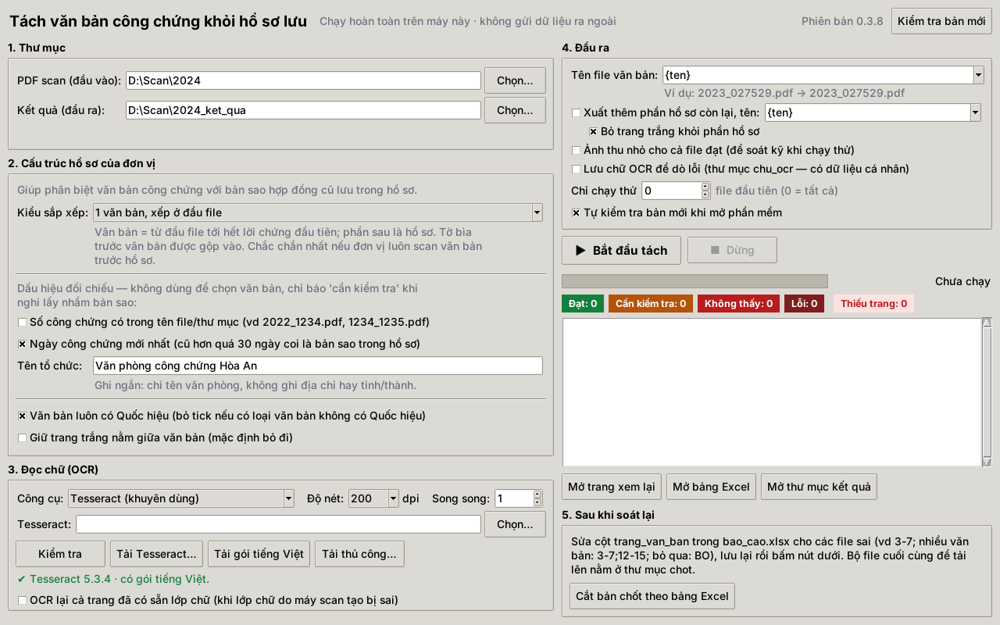

# Tách văn bản công chứng khỏi hồ sơ lưu

Công cụ mã nguồn mở dành cho **tổ chức hành nghề công chứng**. Trước đây nhiều đơn vị scan **văn bản công chứng chung một file với hồ sơ lưu**. Nay cần đưa riêng văn bản công chứng lên Cơ sở dữ liệu công chứng, nên phải tách hai phần này ra.

Công cụ đọc từng trang, nhận ra trang nào thuộc văn bản (từ tiêu đề đến hết lời chứng) và trang nào thuộc hồ sơ (phiếu yêu cầu, CCCD, giấy chứng nhận, bản sao…), rồi cắt văn bản ra thành file PDF riêng. Ảnh scan giữ nguyên chất lượng. Những file chưa chắc chắn được đưa ra để người kiểm tra xem lại.



## Tính năng

- **Chạy hoàn toàn trên máy**, không gửi hồ sơ ra ngoài. Nhận dạng chữ bằng Tesseract OCR có gói tiếng Việt.
- Nhận ra trang tiêu đề, thân hợp đồng, trang ký, lời chứng, trang trắng, và các giấy tờ thường gặp trong hồ sơ.
- **Loại bản sao văn bản công chứng cũ lưu lẫn trong hồ sơ** nhờ các dấu hiệu: số công chứng trong tên file, ngày công chứng, tên tổ chức, vị trí trong file. Dùng được cả khi mỗi file có một văn bản lẫn khi có nhiều văn bản.
- **Phát hiện văn bản bị thiếu, thừa hoặc trùng trang** do scan lỗi: so số trang tách được với câu *"…gồm … tờ, … trang"* trong lời chứng, dò số trang in trên trang và số Điều bị nhảy cóc.
- **Đặt tên file kết quả theo mẫu**, ví dụ `{nam}_{so_cc}_{loai}` → `2023_027529_GIAY_UY_QUYEN.pdf`. Mẫu dùng số công chứng, ngày, loại văn bản đọc được từ lời chứng; sửa tay được trong bảng Excel.
- Trang **xem lại** có ảnh thu nhỏ từng trang. Bảng **Excel** để sửa tay, sau đó **cắt bản chốt** theo bảng.
- Có cả giao diện lẫn dòng lệnh. Xử lý song song nhiều file và nhớ kết quả OCR, nên lần chạy lại gần như tức thì.

## Tải về và sử dụng (Windows)

**Yêu cầu: Windows 10 hoặc Windows 11, bản 64-bit.** Windows 7 và 8.1 không chạy được, vì Python 3.13 mà phần mềm dùng không hỗ trợ hai hệ điều hành này. Trên Windows 7, bản zip sẽ báo lỗi *"Failed to load Python DLL … python313.dll"*.

### ⬇️ [Tải bộ cài (TachVanBan-CaiDat.exe)](https://github.com/phamngocson6596/tach-file-hoso/releases/latest/download/TachVanBan-CaiDat.exe)

Link trên luôn trỏ tới bản mới nhất. Các bản trước xem ở trang **[Releases](../../releases)**. Bộ cài đã kèm sẵn Python, Tesseract và gói tiếng Việt, **không cần cài gì thêm**.

| File | Dùng khi |
|---|---|
| **[`TachVanBan-CaiDat.exe`](https://github.com/phamngocson6596/tach-file-hoso/releases/latest/download/TachVanBan-CaiDat.exe)** (khuyên dùng, nhỏ nhất) | Chạy file, bấm Next là xong. Có biểu tượng ở menu Start và có mục gỡ cài đặt. Mặc định cài cho riêng người dùng hiện tại, **không cần quyền quản trị**. |
| [`TachVanBan-KhongCanCai.zip`](https://github.com/phamngocson6596/tach-file-hoso/releases/latest/download/TachVanBan-KhongCanCai.zip) | Máy không cho cài phần mềm, hoặc muốn chạy từ USB. Giải nén ra một thư mục rồi chạy `TachVanBan.exe`. |

1. Windows có thể hiện cảnh báo *"Windows protected your PC"* vì file chưa được ký số. Bấm **More info**, rồi **Run anyway**.
2. Chọn thư mục PDF scan và thư mục kết quả, khai báo cấu trúc hồ sơ của đơn vị, rồi bấm **Bắt đầu tách**. Lần đầu nên **chạy thử 50 file** và soát kỹ.

**Cập nhật:** khi có bản mới, phần mềm hiện dòng *"Đã có bản mới …"*. Từ bản 0.3.5, bấm **⬆ Cập nhật ngay** là phần mềm tự tải bộ cài (có kiểm tra mã băm SHA-256 với GitHub), tự cài rồi tự mở lại; cấu hình và kết quả cũ được giữ nguyên. Bản 0.3.4 trở về trước thì cần tự tải bộ cài mới một lần.

Hướng dẫn chi tiết, ý nghĩa từng tuỳ chọn và cách sửa tay: **[HUONG_DAN.md](HUONG_DAN.md)**.

## Chạy từ mã nguồn (Windows / macOS / Linux)

Cần Python 3.9 trở lên và Tesseract OCR có gói tiếng Việt (xem HUONG_DAN.md, mục 1).

```
pip install -r requirements.txt
python giao_dien.py                         # giao diện
python tach_van_ban.py "D:\Scan" "D:\KetQua" # dòng lệnh; xem thêm: python tach_van_ban.py -h
python tao_du_lieu_thu.py du_lieu_thu       # tạo 8 file scan giả để thử
```

## Lưu ý khi sử dụng

- Đây là **công cụ hỗ trợ**. Kết quả, kể cả các file báo "Đạt", cần được người có trách nhiệm kiểm tra trước khi đưa lên hệ thống. Công cụ không thay thế việc rà soát theo quy định và không phải tư vấn pháp lý.
- Công cụ chỉ kết nối mạng trong ba trường hợp:
  - khi mở phần mềm, để **hỏi GitHub số phiên bản mới nhất** (chỉ gửi đúng yêu cầu này, tắt được bằng ô *Tự kiểm tra bản mới khi mở phần mềm*);
  - khi bạn bấm **Tải gói tiếng Việt**;
  - khi bạn mở các trang tải về.

  Công cụ không gửi bất kỳ dữ liệu hồ sơ nào ra ngoài.
- Tuỳ chọn *Lưu chữ OCR* tạo ra các file chứa dữ liệu cá nhân. Chỉ bật khi cần dò lỗi và nhớ xoá sau khi dùng.

## Góp ý và báo lỗi

Hãy mở mục **Issues**. Nếu công cụ nhận diện sai, gửi kèm cột `nhan_trang`/`canh_bao` trong `bao_cao.xlsx`, và đoạn chữ OCR của trang bị sai (chạy với tuỳ chọn *Lưu chữ OCR*).

**Bắt buộc che họ tên, số giấy tờ, địa chỉ** trước khi gửi. **Không đưa hồ sơ thật lên GitHub.** File `.gitignore` đã chặn sẵn các file PDF và thư mục kết quả.

Mẫu tiêu đề và lời chứng có thể khác nhau giữa các địa phương. Các danh sách từ khoá nằm ở đầu file `tach_van_ban.py` (`TIEU_DE_VAN_BAN`, `TIEU_DE_HO_SO`, `DAU_HIEU_HO_SO`), rất hoan nghênh đóng góp bổ sung.

## Phát hành bản mới (dành cho người duy trì)

1. Sửa `PHIEN_BAN` trong `tach_van_ban.py` (ví dụ `0.3.1`) rồi commit.
2. Trên GitHub, vào **Releases**, chọn **Draft a new release**, tạo tag `v0.3.1`, ghi chú thay đổi, rồi bấm **Publish release**.
3. Quy trình **"Đóng gói bản Windows"** (`.github/workflows/build-windows.yml`) tự chạy, mất khoảng 5–15 phút. Quy trình này:
   - dựng `TachVanBan.exe` bằng PyInstaller;
   - kèm Tesseract và gói tiếng Việt, đã bỏ các phần không dùng;
   - **tự chạy thử trên dữ liệu giả**, cả bản zip lẫn bản đã cài từ bộ cài;
   - đính **bộ cài `.exe`** và **bản `.zip`** vào release.

   Nếu bước tự kiểm tra không đạt, sẽ không có file nào được đính kèm. Log của bước đóng gói có bảng dung lượng từng thành phần.
4. Muốn dựng thử mà không phát hành: vào tab **Actions**, chọn **Đóng gói bản Windows**, bấm **Run workflow**. Hai file nằm ở mục *Artifacts* của lần chạy.

Muốn đóng gói trên máy Windows của mình: cài Python, Tesseract, Inno Setup 6, `pip install -r requirements.txt pyinstaller`, rồi chạy `powershell -ExecutionPolicy Bypass -File packaging\build_windows.ps1`.

## Giấy phép

Mã nguồn phát hành theo **[GNU AGPL-3.0](LICENSE)**. Bạn được tự do sử dụng, sửa đổi và phân phối lại. Nếu phân phối bản đã sửa đổi (hoặc cung cấp nó qua mạng), bạn phải công khai mã nguồn của bản đó theo cùng giấy phép.

Giấy phép của các thành phần đi kèm bản đóng gói: xem **[THIRD_PARTY_LICENSES.md](THIRD_PARTY_LICENSES.md)**.
